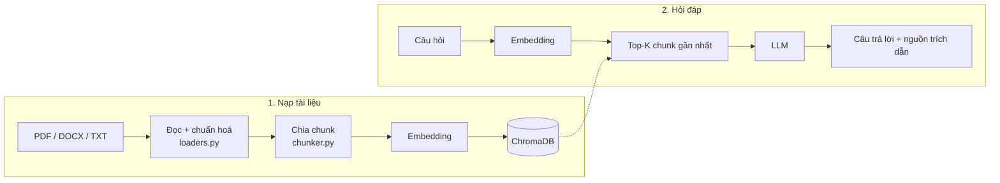

# Document QA RAG

Trợ lý hỏi đáp tài liệu dùng **RAG (Retrieval-Augmented Generation)**: tải lên PDF, DOCX, TXT rồi đặt câu hỏi,
câu trả lời luôn kèm **trích dẫn nguồn** theo tên file và trang/mục để người dùng tự kiểm chứng.


- Hỗ trợ PDF (trích dẫn theo trang), DOCX (theo mục Heading, đọc được cả bảng), TXT/Markdown
- Tìm kiếm ngữ nghĩa với vector embedding + ChromaDB, có thể giới hạn phạm vi hỏi trong một số tài liệu
- Câu trả lời stream từng chữ, mỗi ý gắn số nguồn `[1]`, `[2]`, bấm vào để xem đoạn gốc
- **Crawler** thu thập trang web công khai (tuân thủ robots.txt), câu trả lời trích dẫn bằng link trang gốc
- Chạy miễn phí: **Gemini API** (gói free) hoặc **Ollama** (model chạy trên máy), đổi bằng một biến cấu hình

## Kiến trúc



| Thành phần | Công nghệ |
|---|---|
| LLM | Gemini `gemini-3.5-flash-lite` (mặc định) hoặc Ollama `qwen2.5:7b` |
| Embedding | `gemini-embedding-2` (768 chiều) hoặc Ollama `bge-m3` |
| Vector DB | ChromaDB, khoảng cách cosine |
| Đọc tài liệu | PyMuPDF, python-docx |
| Giao diện | Streamlit |

## Cài đặt

Cần Python 3.10+.

```bash
python -m venv .venv
.venv\Scripts\activate          # macOS/Linux: source .venv/bin/activate
pip install -r requirements.txt
```

Tạo API key Gemini miễn phí tại https://aistudio.google.com/apikey, copy `.env.example` thành `.env` rồi điền:

```
GEMINI_API_KEY=your-key
```

> - `.env` đã nằm trong `.gitignore`: **không bao giờ commit API key**. Lỡ lộ key thì xoá key đó trong AI Studio.
> - Không liên kết tài khoản thanh toán (billing) thì chỉ dùng gói free, không phát sinh phí; hết hạn mức thì API
>   trả lỗi 429 và app tự thử lại.
> - Dữ liệu gửi lên gói free có thể được Google dùng để cải thiện sản phẩm. Tài liệu nhạy cảm hãy dùng Ollama.

## Chạy

```bash
streamlit run app.py
```

Mở http://localhost:8501, tải lên các file trong `sample_docs/` (tài liệu mẫu của một công ty hư cấu) và thử hỏi:

- Chính sách hoàn tiền của công ty như thế nào?
- Máy báo lỗi E2 thì phải làm gì?
- Bộ lọc HEPA được bảo hành bao lâu?
- Công ty có bán ô tô không? *(không có trong tài liệu, hệ thống phải trả lời là không tìm thấy)*

Hoặc dùng trên terminal:

```bash
python cli.py add sample_docs/Chinh_sach_cong_ty.docx sample_docs/Huong_dan_su_dung.pdf
python cli.py ask "Máy báo lỗi E2 thì phải làm gì?" --show-context
```

### Chạy local bằng Ollama (không cần API key)

Cài [Ollama](https://ollama.com/download), tải model rồi đặt `PROVIDER=ollama` trong `.env`:

```bash
ollama pull bge-m3
ollama pull qwen2.5:7b
```

`qwen2.5:7b` cần khoảng 5 GB VRAM/RAM; máy yếu hơn dùng `LLM_MODEL=qwen2.5:3b`.

## Thu thập dữ liệu từ website

`cli.py crawl` đọc sitemap, lọc URL bằng regex, lấy phần nội dung chính của trang (bỏ menu, footer) bằng
[trafilatura](https://trafilatura.readthedocs.io) rồi lưu thành Markdown kèm URL gốc. Khi nạp vào, câu trả lời
trích dẫn bằng link trang web.

Ví dụ: dữ liệu tuyển sinh công khai của Trường Đại học FPT (học phí, học bổng, chuyên ngành, quy chế; khoảng 80 trang,
cấu hình trong [`examples/fpt_education.args`](examples/fpt_education.args)):

```bash
python cli.py crawl @examples/fpt_education.args
python cli.py add web_docs/fpt_education
python cli.py ask "Học phí ngành Trí tuệ nhân tạo tại campus Hà Nội là bao nhiêu?"
```

Dùng cho website khác:

```bash
python cli.py crawl --sitemap https://example.com/sitemap.xml --include "/docs/" --exclude "login" --limit 50
```

Crawler chỉ lấy trang công khai, **tuân thủ robots.txt** của từng site và chờ 1 giây giữa các request (`--delay`).
Nội dung tải về thuộc bản quyền của chủ website nên được lưu ở `web_docs/` (đã có trong `.gitignore`), chỉ dùng cho
học tập và nghiên cứu cá nhân. Muốn đăng lại hay dùng cho mục đích khác, hãy xin phép chủ website.

## Test

Test dùng embedding và LLM giả nên chạy được không cần API key:

```bash
pip install -r requirements-dev.txt
pytest
```

## Cấu trúc

```
app.py                  Giao diện Streamlit
cli.py                  Giao diện dòng lệnh: add, list, ask, crawl
rag/
  config.py             Cấu hình (ghi đè bằng biến môi trường / .env)
  crawler.py            Tải trang web công khai → Markdown kèm URL gốc
  loaders.py            Đọc PDF theo trang, DOCX theo mục, TXT/Markdown; chuẩn hoá Unicode
  chunker.py            Chia chunk đệ quy: đoạn > dòng > câu > từ, có chồng lấn
  llm.py                Chọn provider; phần còn lại không phụ thuộc nhà cung cấp model
  providers/gemini.py   Gemini API (tự retry khi bị giới hạn tần suất)
  providers/ollama.py   Ollama local
  store.py              ChromaDB + danh sách tài liệu
  pipeline.py           ingest() → retrieve() → generate() → cited_sources()
tests/                  pytest (crawler test bằng website giả, không gửi request thật)
sample_docs/            Tài liệu mẫu (công ty hư cấu)
examples/               Cấu hình crawl mẫu
```

## Cấu hình

| Biến | Mặc định | Ý nghĩa |
|---|---|---|
| `PROVIDER` | `gemini` | `gemini` hoặc `ollama` |
| `LLM_MODEL` | `gemini-3.5-flash-lite` | Model sinh câu trả lời (`gemini-3.8-flash` trả lời tốt hơn, hạn mức free thấp hơn) |
| `EMBED_MODEL` | `gemini-embedding-2` | Model embedding |
| `CHUNK_SIZE` / `CHUNK_OVERLAP` | `1000` / `200` | Kích thước chunk và phần chồng lấn (ký tự) |
| `TOP_K` | `5` | Số chunk đưa cho LLM mỗi câu hỏi |

Mỗi model embedding có thư mục dữ liệu riêng trong `data/`, vì vector của các model khác nhau không so sánh được với
nhau. Đổi `CHUNK_SIZE` thì cần xoá `data/` và nạp lại tài liệu.

## Một số quyết định thiết kế

- **Chunk không vắt qua trang PDF**: mỗi trang được chia chunk riêng nên trích dẫn luôn đúng số trang.
- **DOCX trích dẫn theo mục**: file Word không lưu số trang, nên dùng tiêu đề (Heading) gần nhất làm vị trí.
- **Chuẩn hoá Unicode NFC**: cùng một chữ tiếng Việt có thể được lưu ở dạng dựng sẵn hoặc tổ hợp tuỳ phần mềm soạn
  thảo; không chuẩn hoá thì cùng một từ sẽ không khớp nhau khi tìm kiếm.
- **Chống bịa**: prompt yêu cầu chỉ dùng các đoạn trích, ghi nguồn sau mỗi ý và trả lời "không tìm thấy" khi thiếu
  thông tin; temperature thấp (0.1). Chỉ những nguồn được LLM thực sự trích dẫn mới hiện ra cho người dùng.
- **Bỏ qua file trùng**: tài liệu được định danh bằng hash nội dung nên upload lại cùng file không tạo dữ liệu trùng.

## Giới hạn và hướng phát triển

- [ ] Bộ câu hỏi đánh giá, đo Hit@K / MRR cho retrieval và độ đúng của câu trả lời
- [ ] Hybrid search (BM25 + vector) để bắt tốt từ khoá, mã số, tên riêng
- [ ] Reranker chấm lại các chunk trước khi đưa cho LLM
- [ ] Hiểu câu hỏi nối tiếp dựa trên lịch sử chat
- [ ] OCR cho PDF dạng ảnh scan, nạp URL trực tiếp từ giao diện web
- [ ] Tách backend FastAPI, đóng gói Docker, deploy
