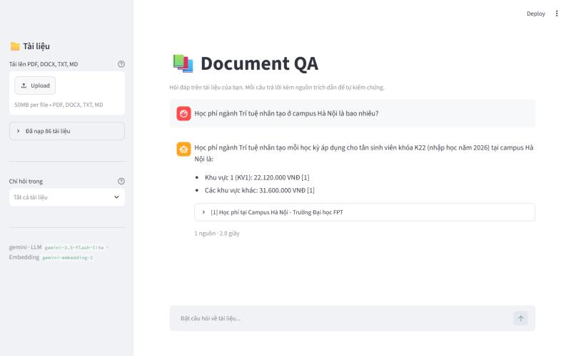
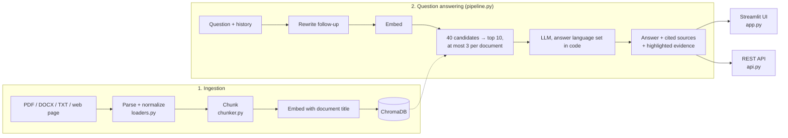

# Document QA RAG

[](https://github.com/VuTien1311/document-qa-rag/actions/workflows/ci.yml)

Question answering over your own documents with **RAG (Retrieval-Augmented Generation)**. Upload PDF, DOCX or TXT
files, or crawl a website, then ask questions: every answer **cites its sources** and shows the passage, or the
original PDF page, it came from, so users can verify it.



- PDF (cited by page), DOCX (cited by heading, tables included), TXT/Markdown and crawled web pages (cited by URL)
- **Verifiable answers**: each source opens the excerpt with the supporting lines highlighted and, for PDFs, an image
  of the original page with the cited passage marked
- **Follow-up questions** ("and in Da Nang?") are rewritten from the conversation before searching
- Ask in English or Vietnamese: answers follow the language of the question, whatever the document language
- **Evaluation suite** (63 labeled questions) and an **Evaluation page** in the app: every setting was chosen from
  measurements rather than guesswork
- **REST API** (FastAPI) with streaming answers, **Docker** image and **CI** (lint, tests, image build)
- **Web crawler** for public sites that respects robots.txt
- Runs for free: **Gemini API** (free tier) or **Ollama** (local models), switched with one setting

## Architecture



| Component | Technology |
|---|---|
| LLM | Gemini `gemini-3.5-flash-lite` (default) or Ollama `qwen2.5:7b` |
| Embeddings | `gemini-embedding-2` (768 dimensions) or Ollama `bge-m3` |
| Vector store | ChromaDB, cosine distance |
| Parsing | PyMuPDF, python-docx, trafilatura (web pages) |
| UI / API | Streamlit / FastAPI |

## Setup

Requires Python 3.10+.

```bash
python -m venv .venv
.venv\Scripts\activate          # macOS/Linux: source .venv/bin/activate
pip install -r requirements.txt
```

Create a free Gemini API key at https://aistudio.google.com/apikey, copy `.env.example` to `.env` and fill in:

```
GEMINI_API_KEY=your-key
```

> - `.env` is in `.gitignore` and `.dockerignore`: **never commit your API key**. If a key leaks, delete it in AI Studio.
> - Without a linked billing account you stay on the free tier and cannot be charged; when the quota runs out the API
>   returns HTTP 429 and the app retries or explains the error.
> - Free-tier requests may be used by Google to improve its products. Use Ollama for sensitive documents.

## Usage

### Web UI

```bash
streamlit run app.py
```

Open http://localhost:8501 (the app only listens on localhost), click **Load sample documents** (Vietnamese documents
of a fictional company) and try a suggested question, or ask your own, for example:

- *What should I do when the air purifier shows error E2?* Expand the source to see the original PDF page.
- *And error E3?* A follow-up: the app shows the full question it searched for.
- *Does the company sell cars?* Not in the documents, so the app must say it could not find it.

The **Evaluation** page shows the scores of every configuration tried. Each 👍/👎 is appended to
`data/<embedding model>/feedback.jsonl` with the question, answer and sources, so poorly answered questions can be
labeled and added to the evaluation set.

### REST API

```bash
uvicorn api:app --reload        # interactive docs: http://localhost:8000/docs
```

```bash
curl -X POST localhost:8000/ask -H "Content-Type: application/json" -d "{\"question\": \"What is error E2?\"}"
```

| Endpoint | Purpose |
|---|---|
| `GET /documents`, `POST /documents`, `DELETE /documents/{id}` | List, upload (multipart), remove documents |
| `POST /ask` | Answer with cited sources, evidence lines and the searched query; accepts `history` and `doc_ids` |
| `POST /ask/stream` | Same, as Server-Sent Events: `token` events while the answer is generated, then `sources` |
| `GET /chunks/{id}/page.png` | The PDF page of a source with the passage highlighted |

### Docker

```bash
docker compose up --build       # UI on http://localhost:8501, API docs on http://localhost:8000/docs
```

Both services read the API key from `.env` and share the `data/` folder; ports are bound to 127.0.0.1 so nobody else on
the network can use your quota. Avoid adding documents from both at the same time.

### Command line

```bash
python cli.py add sample_docs                      # ingest a folder or individual files
python cli.py ask "Máy báo lỗi E2 thì phải làm gì?" --show-context
```

### Running locally with Ollama (no API key)

Install [Ollama](https://ollama.com/download), pull the models and set `PROVIDER=ollama` in `.env`:

```bash
ollama pull bge-m3
ollama pull qwen2.5:7b
```

`qwen2.5:7b` needs about 5 GB of VRAM/RAM; on smaller machines use `LLM_MODEL=qwen2.5:3b`.

## Crawling websites

`cli.py crawl` reads sitemaps, filters URLs with regular expressions, extracts each page's main content (no menus or
footers) with [trafilatura](https://trafilatura.readthedocs.io) and saves it as Markdown with the source URL, so
answers cite the original page.

Example: public admissions information of FPT University (tuition, scholarships, majors, regulations; about 80 pages,
configured in [`examples/fpt_education.args`](examples/fpt_education.args)):

```bash
python cli.py crawl @examples/fpt_education.args
python cli.py add web_docs/fpt_education
python cli.py ask "Học phí ngành Trí tuệ nhân tạo tại campus Hà Nội là bao nhiêu?"
```

For any other site:

```bash
python cli.py crawl --sitemap https://example.com/sitemap.xml --include "/docs/" --exclude "login" --limit 50
```

The crawler only fetches public pages, **respects each site's robots.txt** and waits 1 second between requests
(`--delay`). Downloaded content belongs to the site owner, so it is stored in `web_docs/` (git-ignored) for personal
study and research only. Ask the owner for permission before republishing it or using it for anything else.

## Evaluation

Labeled questions over the FPT admissions data, in [`eval/`](eval). Each question lists the URLs that contain the
answer and the facts a correct answer must include:

- [`fpt_questions.jsonl`](eval/fpt_questions.jsonl): **51 Vietnamese questions**: 38 facts (tuition by campus,
  scholarships, admission rules, program codes...), 9 lists whose answers span several pages, and 4 out-of-scope
  questions the system must refuse instead of making something up
- [`fpt_questions_en.jsonl`](eval/fpt_questions_en.jsonl): **6 English questions** over the Vietnamese pages
- [`fpt_followups.jsonl`](eval/fpt_followups.jsonl): **6 follow-up questions** with the conversation before them

| Metric | Meaning |
|---|---|
| Hit@K | Share of questions with at least one correct source among the K chunks given to the LLM |
| MRR | Mean of 1 / rank of the first correct chunk: higher means correct sources rank first |
| Recall@K | Share of the correct sources retrieved in the K chunks; matters for list questions |
| Coverage | Share of required facts present in the answer |
| Cited | Share of answers that cite at least one source `[n]` |
| Correct refusals | Out-of-scope questions answered with "not found" |

```bash
python cli.py eval eval/fpt_questions.jsonl               # retrieval only (51 embedding calls)
python cli.py eval eval/fpt_questions.jsonl --answers     # also score answers (51 more LLM calls)
python cli.py eval eval/fpt_followups.jsonl --answers --no-rewrite   # compare without follow-up rewriting
python cli.py eval eval/fpt_questions.jsonl --answers --report eval/reports/my-run.json --description "..."
```

`--report` saves a summary (scores and failed question ids, no answers) to [`eval/reports/`](eval/reports), which the
Evaluation page reads.

### Results

Gemini `gemini-3.5-flash-lite` + `gemini-embedding-2`; 83 FPT pages plus 3 sample documents (about 550 chunks).

| Configuration (51 Vietnamese questions) | Hit@K | MRR | Recall@K (lists) | Fact coverage | List coverage | Cited | Refusals |
|---|---|---|---|---|---|---|---|
| Baseline: K=5 | 0.98 | 0.93 | 0.57 | 94.7% | 97.8% | 94% | 4/4 |
| K=8 | 0.98 | 0.93 | 0.68 | 97.4% | 100% | 96% | 4/4 |
| K=8 + document title in embeddings | 0.98 | 0.93 | 0.53 | 97.4% | 89.1% | 98% | 4/4 |
| **K=10 + titles + at most 3 chunks per document (default)** | **1.00** | **0.94** | 0.71 | **100%** | 97.8% | **100%** | 4/4 |
| Default + hybrid search (rejected) | 1.00 | 0.92 | 0.76 | 94.7% | 90.0% | 94% | 4/4 |

| Other question sets | Coverage | Cited |
|---|---|---|
| 6 English questions (default) | 100% | 100% |
| 6 follow-ups searched as typed | 66.7% | 83% |
| **6 follow-ups rewritten from the conversation (default)** | **100%** | **100%** |

With 51 questions, a difference of one or two questions is not statistically strong evidence; what each step does show
is which concrete failures it fixed without introducing new ones.

**Error analysis** (reading every failure to find its cause instead of tuning blindly):

- *English Studies tuition at the Quy Nhon campus* was answered "not found". The tuition table is split across chunks,
  and the chunk holding the "Ngôn ngữ Anh" row no longer mentions "Quy Nhơn", so it ranked 7th, outside the top 5.
  Raising K fixed it.
- *Does Greenwich Vietnam offer an AI program?* failed to retrieve the right page: the page never contains the word
  "Greenwich" (its extracted title is "FPT Education"); only the URL `.../greenwich-viet-nam` does. Embedding each
  chunk together with its document title and URL fixed it.
- Titles made list answers **worse** (100% → 89.1%): every chunk of a page now shares the same title, so a page whose
  title matches the question fills the top results. For "Which majors relate to AI and data?" all 8 retrieved chunks
  came from one page (4 distinct pages before). Allowing at most 3 chunks per document, picked from the top 40
  candidates, restored source diversity.
- English questions were first answered in **Vietnamese** (4 of 6), pulled along by the Vietnamese excerpts; the
  keyword metrics could not see it. Telling the model to answer "in the language of the question" fixed only half, so
  the language is now detected in code (Vietnamese words versus English function words, so an English question that
  names a Vietnamese scholarship still counts as English) and stated in the prompt. All 6 English answers are now in
  English and all 51 Vietnamese answers stay in Vietnamese.
- Follow-ups such as *"Còn ở Đà Nẵng thì sao?"* ("And in Da Nang?") retrieved Da Nang pages but the model did not know
  the question was about AI tuition. Rewriting them into a full question first (one extra LLM call, only when there is
  a conversation) raised coverage from 66.7% to 100%.
- Remaining failure: *IT tuition across campuses* omits Quy Nhon. Four other campus pages fill all 10 slots with 2–3
  chunks each, so the Quy Nhon page is not retrieved.

**Tried and rejected:**

- *Hybrid search (BM25 + vectors, reciprocal rank fusion)*: recall went up (lists 0.71 → 0.76) but answers got worse
  (facts 100% → 94.7%, lists 97.8% → 90%). Keyword search favours pages that repeat words such as "học phí" and
  "Quy Nhơn" (admissions overview, financial policy), which crowd out the table row with the answer; and for English
  questions it has no words in common with Vietnamese text (MRR 1.00 → 0.74). Kept behind `HYBRID_SEARCH=true` for
  document sets with many exact codes.
- *At most 2 chunks per document*: fixes the Quy Nhon list question but drops a needed passage from long pages. Without
  titles it turned "Who was the first rector?" into a **confidently wrong** answer: the passage with the answer was the
  page's 3rd chunk and got cut, while the 2nd chunk named the current rector, and the model merged the two.
- *A prompt rule telling the model to merge items from all excerpts for list questions*: no measurable change.
- *Reranker*: not added. Gemini has no reranking endpoint on the free tier, and a local cross-encoder would add PyTorch
  (about 2 GB) for little headroom: the right chunk is already in the top 10 for every question (Hit@10 = 1.00) and
  the remaining failure is source diversity, not ranking.

> The free tier of `gemini-embedding-2` allows 1,000 requests per day and **every chunk counts as one request**:
> re-ingesting the data above costs about 550 requests and one evaluation run 51.

## Tests

Tests use fake embeddings and a fake LLM, so they run without an API key or network access. CI runs them, the linter
and a Docker build on every push.

```bash
pip install -r requirements-dev.txt
pytest
```

## Project structure

```
app.py                  Streamlit entry point (Chat and Evaluation pages)
ui/chat.py              Chat page: documents, answers, sources with highlighted evidence and PDF pages
ui/evaluation.py        Evaluation page: scores and charts from eval/reports
api.py                  FastAPI REST API, including streaming answers
cli.py                  Command line: add, list, ask, crawl, eval
rag/
  config.py             Settings (overridable via environment variables / .env)
  crawler.py            Public web pages → Markdown with the source URL
  loaders.py            PDF by page, DOCX by heading, TXT/Markdown; Unicode normalization
  chunker.py            Recursive chunking: paragraph > line > sentence > word, with overlap
  llm.py                Picks the provider; the rest of the code is provider-agnostic
  providers/gemini.py   Gemini API (retries on rate limits)
  providers/ollama.py   Local Ollama models
  store.py              ChromaDB + document registry
  keyword_search.py     BM25 keyword search (optional hybrid search)
  pipeline.py           ingest() → standalone_question() → retrieve() → generate() → cited_sources()
  evidence.py           Supporting lines for each citation; highlighted PDF page images
  evaluation.py         Hit@K, MRR, Recall@K, coverage, citations and refusals on labeled questions
tests/                  pytest (API, crawler with a mocked website, pipeline, evaluation...)
eval/                   Labeled questions and summary reports
sample_docs/            Sample documents (fictional company)
examples/               Example crawl configuration
Dockerfile, docker-compose.yml, .github/workflows/ci.yml
```

## Configuration

| Variable | Default | Meaning |
|---|---|---|
| `PROVIDER` | `gemini` | `gemini` or `ollama` |
| `LLM_MODEL` | `gemini-3.5-flash-lite` | Answer model (`gemini-3.8-flash` answers better but has a lower free quota) |
| `EMBED_MODEL` | `gemini-embedding-2` | Embedding model |
| `CHUNK_SIZE` / `CHUNK_OVERLAP` | `1000` / `200` | Chunk size and overlap (characters) |
| `TOP_K` | `10` | Chunks given to the LLM per question (chosen from the evaluation above) |
| `MAX_CHUNKS_PER_DOC` | `3` | At most this many of those chunks per document, `0` = no limit |
| `HYBRID_SEARCH` | `false` | Also rank chunks with BM25 keyword search (worse on this data, see the evaluation) |

Each embedding model gets its own data folder under `data/`, because vectors from different models cannot be compared.
After changing `CHUNK_SIZE`, delete `data/` and ingest the documents again.

## Design decisions

- **Chunks never span PDF pages**: each page is chunked separately, so page citations are always exact and the
  original page can be shown.
- **Embeddings include the document title**: each chunk is embedded together with a "title — location" line (used only
  for the vector, never shown), so a chunk cut from the middle of a table or page still "knows" which document it
  belongs to. Because this makes chunks of the same page similar to each other, retrieval takes 40 candidates and keeps
  at most 3 chunks per document in the final 10.
- **Evidence highlighting**: for each citation, the lines of the passage sharing the most words and numbers with the
  sentences citing it are highlighted; numbers and codes ("22.120.000", "E2") count triple, which also works when an
  English answer cites a Vietnamese document. PDF pages are rendered with PyMuPDF and annotated in memory only.
- **Follow-up rewriting**: with a conversation, the question is first rewritten into a self-contained one, and the UI
  shows what was searched. The first question of a conversation costs no extra call.
- **Answer language is set in code**: the question is classified as Vietnamese or English and the prompt names the
  language explicitly, because Vietnamese excerpts otherwise pull answers to English questions into Vietnamese.
- **DOCX is cited by section**: Word files do not store page numbers, so the nearest heading is used as the location.
- **Unicode NFC normalization**: the same Vietnamese letter can be stored precomposed or decomposed depending on the
  editor; without normalization identical words would not match during search.
- **Guarding against made-up answers**: the prompt allows only the provided excerpts, requires a source after every
  claim and a "not found" reply when information is missing; temperature is low (0.1). Only sources the LLM actually
  cites are shown to the user.
- **Duplicate files are skipped**: documents are identified by a hash of their content, so re-uploading the same file
  adds nothing.

## Limitations and roadmap

- [x] Labeled evaluation sets (Vietnamese, English, follow-ups) and an Evaluation page
- [x] Follow-up questions that use the chat history
- [x] Hybrid search (BM25 + vectors): implemented and measured, off by default
- [x] FastAPI backend, Docker image and CI
- [ ] Larger evaluation set; grade answers with an LLM judge instead of keyword matching
- [ ] Repeat table headers in every chunk of a split table
- [ ] OCR for scanned PDFs; adding URLs directly from the web UI
- [ ] Public deployment of a demo with the sample documents only
