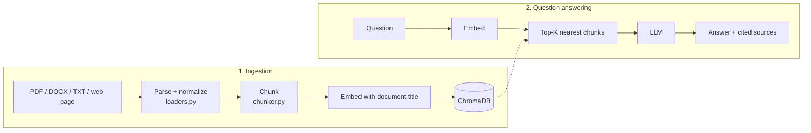

# Document QA RAG

Question answering over your own documents with **RAG (Retrieval-Augmented Generation)**. Upload PDF, DOCX or TXT
files, or crawl a website, then ask questions: every answer **cites its sources** (file and page/section, or the web
page URL) so users can verify it.


- PDF (cited by page), DOCX (cited by heading, tables included), TXT/Markdown and crawled web pages (cited by URL)
- Semantic search with vector embeddings and ChromaDB, optionally restricted to selected documents
- Streaming answers where every claim carries a source number `[1]`, `[2]` that expands to the original passage
- Chat UI with suggested questions, readable source titles, answer time, delete confirmation and plain-language
  errors (quota exhausted, invalid API key)
- **Web crawler** for public sites that respects robots.txt
- **Evaluation suite** (51 labeled questions) used to choose settings from measurements rather than guesswork
- Runs for free: **Gemini API** (free tier) or **Ollama** (local models), switched with one setting

## Architecture



| Component | Technology |
|---|---|
| LLM | Gemini `gemini-3.5-flash-lite` (default) or Ollama `qwen2.5:7b` |
| Embeddings | `gemini-embedding-2` (768 dimensions) or Ollama `bge-m3` |
| Vector store | ChromaDB, cosine distance |
| Parsing | PyMuPDF, python-docx, trafilatura (web pages) |
| UI | Streamlit |

## Setup

Requires Python 3.10+.

```bash
python -m venv .venv
.venv\Scripts\activate          # macOS/Linux: source .venv/bin/activate
pip install -r requirements.txt
```

Create a free Gemini API key at https://aistudio.google.com/apikey, copy `.env.example` to `.env` and fill in:

```
GEMINI_API_KEY=your-key
```

> - `.env` is in `.gitignore`: **never commit your API key**. If a key leaks, delete it in AI Studio.
> - Without a linked billing account you stay on the free tier and cannot be charged; when the quota runs out the API
>   returns HTTP 429 and the app retries or explains the error.
> - Free-tier requests may be used by Google to improve its products. Use Ollama for sensitive documents.

## Usage

```bash
streamlit run app.py
```

Open http://localhost:8501 (the app only listens on localhost), upload the files in `sample_docs/` (documents of a
fictional company) and try the suggested questions, for example:

- *Máy lọc không khí báo lỗi E2 thì phải làm gì?* (What should I do when the air purifier shows error E2?)
- *Công ty có bán ô tô không?* (Does the company sell cars? Not in the documents, so the app must say it found nothing.)

From the command line:

```bash
python cli.py add sample_docs                      # ingest a folder or individual files
python cli.py ask "Máy báo lỗi E2 thì phải làm gì?" --show-context
```

### Running locally with Ollama (no API key)

Install [Ollama](https://ollama.com/download), pull the models and set `PROVIDER=ollama` in `.env`:

```bash
ollama pull bge-m3
ollama pull qwen2.5:7b
```

`qwen2.5:7b` needs about 5 GB of VRAM/RAM; on smaller machines use `LLM_MODEL=qwen2.5:3b`.

## Crawling websites

`cli.py crawl` reads sitemaps, filters URLs with regular expressions, extracts each page's main content (no menus or
footers) with [trafilatura](https://trafilatura.readthedocs.io) and saves it as Markdown with the source URL, so
answers cite the original page.

Example: public admissions information of FPT University (tuition, scholarships, majors, regulations; about 80 pages,
configured in [`examples/fpt_education.args`](examples/fpt_education.args)):

```bash
python cli.py crawl @examples/fpt_education.args
python cli.py add web_docs/fpt_education
python cli.py ask "Học phí ngành Trí tuệ nhân tạo tại campus Hà Nội là bao nhiêu?"
```

For any other site:

```bash
python cli.py crawl --sitemap https://example.com/sitemap.xml --include "/docs/" --exclude "login" --limit 50
```

The crawler only fetches public pages, **respects each site's robots.txt** and waits 1 second between requests
(`--delay`). Downloaded content belongs to the site owner, so it is stored in `web_docs/` (git-ignored) for personal
study and research only. Ask the owner for permission before republishing it or using it for anything else.

## Evaluation

A set of 51 labeled questions over the FPT admissions data lives in
[`eval/fpt_questions.jsonl`](eval/fpt_questions.jsonl). Each question lists the URLs that contain the answer and the
facts a correct answer must include:

- **38 fact questions**: tuition by campus, scholarships, admission rules, program codes...
- **9 list questions**: answers spread over several pages (all scholarships, tuition across campuses, finance majors...)
- **4 out-of-scope questions**: the system must say it found nothing instead of making something up

| Metric | Meaning |
|---|---|
| Hit@K | Share of questions with at least one correct source among the K chunks given to the LLM |
| MRR | Mean of 1 / rank of the first correct chunk: higher means correct sources rank first |
| Recall@K | Share of the correct sources retrieved in the K chunks; matters for list questions |
| Coverage | Share of required facts present in the answer |
| Correct refusals | Out-of-scope questions answered with "not found" |

```bash
python cli.py eval eval/fpt_questions.jsonl            # retrieval only (51 embedding calls)
python cli.py eval eval/fpt_questions.jsonl --answers  # also score answers (51 more LLM calls)
```

### Results

Gemini `gemini-3.5-flash-lite` + `gemini-embedding-2`; 83 FPT pages plus 3 sample documents (about 550 chunks).

| Configuration | Hit@K | MRR | Recall@K (lists) | Fact coverage | List coverage | Correct refusals |
|---|---|---|---|---|---|---|
| Baseline: K=5 | 0.98 | 0.93 | 0.57 | 94.7% | 97.8% | 4/4 |
| K=8 | 0.98 | 0.93 | 0.68 | 97.4% | 100% | 4/4 |
| K=8 + document title in embeddings | 0.98 | 0.93 | 0.53 | 97.4% | 89.1% | 4/4 |
| **K=10 + titles + at most 3 chunks per document (default)** | **1.00** | **0.94** | **0.71** | **100%** | 97.8% | 4/4 |

With 51 questions, a difference of one or two questions is not statistically strong evidence; what each step does show
is which concrete failures it fixed without introducing new ones.

**Error analysis** (reading every failure to find its cause instead of tuning blindly):

- *English Studies tuition at the Quy Nhon campus* was answered "not found". The tuition table is split across chunks,
  and the chunk holding the "Ngôn ngữ Anh" row no longer mentions "Quy Nhơn", so it ranked 7th, outside the top 5.
  Raising K fixed it.
- *Does Greenwich Vietnam offer an AI program?* failed to retrieve the right page: the page never contains the word
  "Greenwich" (its extracted title is "FPT Education"); only the URL `.../greenwich-viet-nam` does. Embedding each
  chunk together with its document title and URL fixed it.
- Titles made list answers **worse** (100% → 89.1%): every chunk of a page now shares the same title, so a page whose
  title matches the question fills the top results. For "Which majors relate to AI and data?" all 8 retrieved chunks
  came from one page (4 distinct pages before). Allowing at most 3 chunks per document, picked from the top 40
  candidates, restored source diversity.
- Remaining failure: *IT tuition across campuses* omits Quy Nhon. Four other campus pages fill all 10 slots with 2–3
  chunks each, so the Quy Nhon page is not retrieved.

**Tried and rejected:**

- *At most 2 chunks per document*: fixes the Quy Nhon list question but drops a needed passage from long pages. Without
  titles it turned "Who was the first rector?" into a **confidently wrong** answer: the passage with the answer was the
  page's 3rd chunk and got cut, while the 2nd chunk named the current rector, and the model merged the two. With titles
  it lost the Da Nang Marketing tuition.
- *A prompt rule telling the model to merge items from all excerpts for list questions*: no measurable change, so the
  simpler prompt was kept.

> The free tier of `gemini-embedding-2` allows 1,000 requests per day and **every chunk counts as one request**:
> re-ingesting the data above costs about 550 requests and one evaluation run 51.

## Tests

Tests use fake embeddings and a fake LLM, so they run without an API key or network access:

```bash
pip install -r requirements-dev.txt
pytest
```

## Project structure

```
app.py                  Streamlit UI
cli.py                  Command line: add, list, ask, crawl, eval
rag/
  config.py             Settings (overridable via environment variables / .env)
  crawler.py            Public web pages → Markdown with the source URL
  evaluation.py         Hit@K, MRR, Recall@K and coverage on a labeled question set
  loaders.py            PDF by page, DOCX by heading, TXT/Markdown; Unicode normalization
  chunker.py            Recursive chunking: paragraph > line > sentence > word, with overlap
  llm.py                Picks the provider; the rest of the code is provider-agnostic
  providers/gemini.py   Gemini API (retries on rate limits)
  providers/ollama.py   Local Ollama models
  store.py              ChromaDB + document registry
  pipeline.py           ingest() → retrieve() → generate() → cited_sources()
tests/                  pytest (crawler tests use a mocked website, no real requests)
sample_docs/            Sample documents (fictional company)
examples/               Example crawl configuration
eval/                   Labeled evaluation questions
```

## Configuration

| Variable | Default | Meaning |
|---|---|---|
| `PROVIDER` | `gemini` | `gemini` or `ollama` |
| `LLM_MODEL` | `gemini-3.5-flash-lite` | Answer model (`gemini-3.8-flash` answers better but has a lower free quota) |
| `EMBED_MODEL` | `gemini-embedding-2` | Embedding model |
| `CHUNK_SIZE` / `CHUNK_OVERLAP` | `1000` / `200` | Chunk size and overlap (characters) |
| `TOP_K` | `10` | Chunks given to the LLM per question (chosen from the evaluation above) |
| `MAX_CHUNKS_PER_DOC` | `3` | At most this many of those chunks per document, `0` = no limit (see the evaluation) |

Each embedding model gets its own data folder under `data/`, because vectors from different models cannot be compared.
After changing `CHUNK_SIZE`, delete `data/` and ingest the documents again.

## Design decisions

- **Chunks never span PDF pages**: each page is chunked separately, so page citations are always exact.
- **Embeddings include the document title**: each chunk is embedded together with a "title — location" line (used only
  for the vector, never shown), so a chunk cut from the middle of a table or page still "knows" which document it
  belongs to. Because this makes chunks of the same page similar to each other, retrieval takes 40 candidates and keeps
  at most 3 chunks per document in the final 10.
- **DOCX is cited by section**: Word files do not store page numbers, so the nearest heading is used as the location.
- **Unicode NFC normalization**: the same Vietnamese letter can be stored precomposed or decomposed depending on the
  editor; without normalization identical words would not match during search.
- **Guarding against made-up answers**: the prompt allows only the provided excerpts, requires a source after every
  claim and a "not found" reply when information is missing; temperature is low (0.1). Only sources the LLM actually
  cites are shown to the user.
- **Duplicate files are skipped**: documents are identified by a hash of their content, so re-uploading the same file
  adds nothing.

## Limitations and roadmap

- [x] Labeled evaluation set measuring Hit@K / MRR / Recall for retrieval and answer completeness
- [ ] Larger evaluation set; grade answers with an LLM judge instead of keyword matching
- [ ] Hybrid search (BM25 + vectors) to better match keywords, codes and names
- [ ] Reranker that re-scores chunks before they reach the LLM
- [ ] Follow-up questions that use the chat history
- [ ] OCR for scanned PDFs; adding URLs directly from the web UI
- [ ] Separate FastAPI backend, Docker image and deployment
